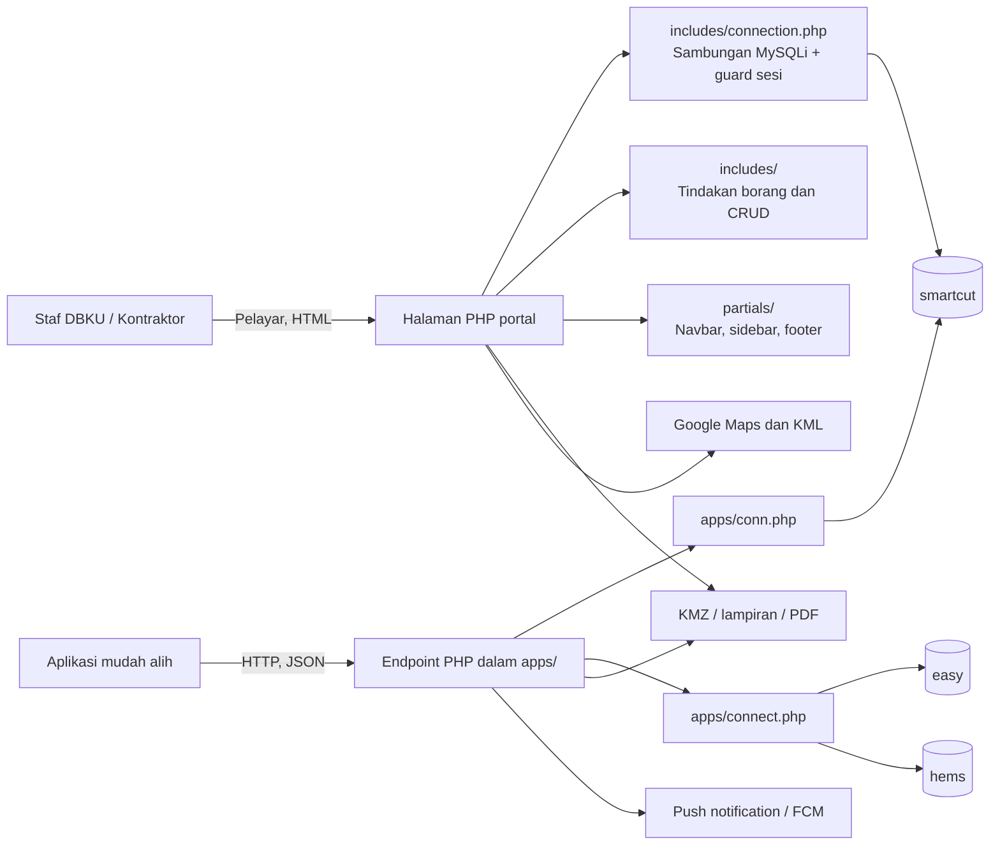
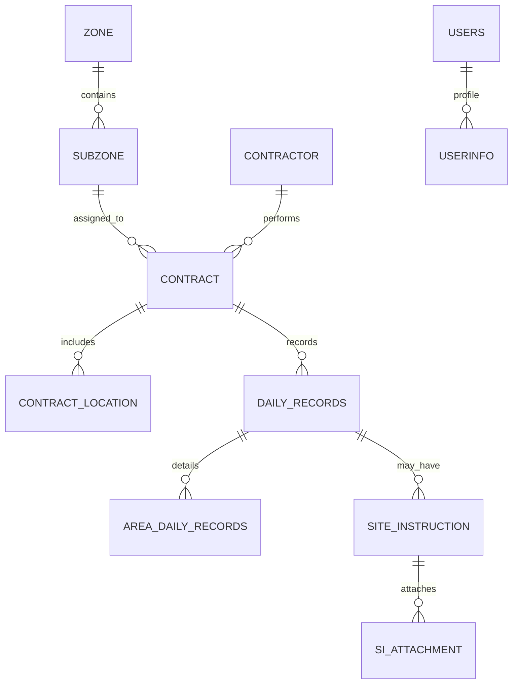

# Seni Bina Sistem GMS / SmartCut

Tarikh semakan: 2026-10-24  
Skop: struktur source dalam checkout ini dan pangkalan SmartCut yang dirujuknya. Dokumen ini menerangkan seni bina yang kelihatan dalam kod; ia bukan pengesahan deployment atau runtime.

## Gambaran keseluruhan

GMS ialah aplikasi web PHP prosedural dengan dua permukaan penggunaan:

1. **Portal web** untuk staf DBKU dan pengurusan operasi. Halaman PHP di akar projek membina paparan HTML dan memanggil tindakan di `includes/`.
2. **API mudah alih** berupa fail PHP terus di `apps/`. Endpoint menerima parameter HTTP, menjalankan query MySQLi dan lazimnya memulangkan JSON. Dalam checkout ini tiada router API pusat atau lapisan controller/service bersama.

Kedua-duanya menggunakan pangkalan data relasi. Portal web berpusat pada `smartcut`; sebahagian endpoint aplikasi mudah alih turut menyokong skema warisan `easy` dan `hems`.

## Lapisan dan tanggungjawab

| Lapisan | Komponen | Tanggungjawab semasa |
|---|---|---|
| Antaramuka web | Halaman `.php` di akar projek | Dashboard dan borang untuk zon, subzon, kontrak, kontraktor, rekod tapak, SI serta pengguna. PHP menjana HTML di server. |
| Rangka paparan | `partials/`, `assets/` | Navbar/sidebar/footer bersama Bootstrap/Stellar dan JavaScript vendor. Dashboard menggunakan lapisan `modern-dashboard.css`; halaman tertentu mempunyai gaya setempat. |
| Kawalan web | `includes/` dan kod halaman | Pengesahan sesi, pemprosesan borang, validasi, query dan arahan redirect. Kebanyakan logik ditulis terus dalam fail halaman/tindakan, bukan melalui controller/domain service pusat. |
| API mudah alih | `apps/*.php` | Endpoint berasingan untuk log masuk, data dashboard, buku harian, SI, tandatangan, lokasi, kehadiran, profil dan notifikasi. Bentuk request/response ditentukan oleh setiap fail. |
| Akses data | MySQLi di `includes/connection.php`, `apps/conn.php`, `apps/connect.php` | Sambungan dan query SQL ditulis terus dalam halaman/tindakan/endpoint. Tiada ORM atau repositori data pusat dikenal pasti. |
| Simpanan fail dan integrasi | `kmz/`, `apps/attachment/`, `dompdf/`, Google Maps, Firebase | Fail geodata dan lampiran, penjanaan PDF, paparan KML serta penghantaran push notification. |

## Aliran request

### Portal web

1. Pelayar meminta halaman PHP di akar projek.
2. Halaman dalaman memuatkan `includes/connection.php`; fail ini memuatkan konfigurasi `includes/x.php`, membuka sambungan MySQLi dan memeriksa `$_SESSION['user_id']`.
3. Halaman menjalankan query atau memasukkan partial untuk rangka UI.
4. Borang dihantar kepada tindakan PHP (biasanya dalam `includes/`), yang mengesahkan input dan melaksanakan operasi pangkalan data.
5. Pengguna menerima HTML atau redirect. Laporan tertentu dirender sebagai PDF melalui dompdf.

Log masuk diproses oleh `includes/login_action.php`: akaun dibaca daripada `users`, kata laluan diperiksa dengan `password_verify`, dan akaun mesti berstatus aktif. Guard pusat yang diperiksa mengesahkan sesi; kawalan peranan tidak ditetapkan secara menyeluruh oleh guard itu dan perlu diperiksa pada tindakan/halaman masing-masing.

### API mudah alih

1. Aplikasi memanggil URL fail tertentu di `apps/` dan menghantar parameter melalui HTTP.
2. Endpoint memilih helper sambungan (`conn.php` untuk SmartCut atau `connect.php` bagi aliran warisan).
3. Endpoint membaca atau mengubah jadual, memproses fail jika berkenaan, kemudian menulis JSON ke response.
4. Tiada router atau middleware autentikasi bersama yang menyatukan semua endpoint dalam source yang diperiksa. Semakan identiti dan input berbeza mengikut endpoint.

`apps/login.php` mengesahkan kata laluan dengan `password_verify` dan mengembalikan medan bernama `sessionToken`. Cara token itu dikeluarkan/diurus tidak patut dianggap sebagai pengesahan semua endpoint; semak setiap laluan API sebelum perubahan integrasi.

## Domain data utama

Pangkalan SmartCut semasa yang dipetakan mempunyai 23 jadual. Hubungan domain utama:

Model yang paling penting untuk operasi:

- `zone` dan `subzone` menyusun lokasi pentadbiran/kerja.
- `contractor`, `contract` dan `contract_location` menetapkan pihak, kontrak serta lokasi kerja.
- `daily_records` menyimpan header buku harian; `area_daily_records` menyimpan kemajuan mengikut lokasi.
- `site_instruction` menyimpan arahan tapak, manakala `si_attachment` menyimpan rujukan lampiran.
- `users`, `userinfo`, `access_level` dan `contractor_users` menyokong akaun dan profil.
- `kmz_file` menyimpan rujukan geodata; `attendance`, `staff_checkin`, `notifications` dan `user_fcm_tokens` menyokong fungsi tambahan.

Skema yang diperiksa tidak mempunyai foreign key. Hubungan dibuat melalui ID dan JOIN dalam kod, maka integriti rujukan bergantung pada validasi aplikasi. Nama medan `daily_records.cid` merujuk ID kontrak dalam query yang dipetakan, sedangkan `contractor.cid` ialah ID kontraktor.

## Pangkalan data dan integrasi

| Sambungan | Helper | Peranan yang kelihatan dalam source |
|---|---|---|
| SmartCut | `includes/connection.php` → `includes/x.php`; `apps/conn.php` → `apps/x.php` | Portal web dan kebanyakan API operasi SmartCut. |
| `easy` | `apps/connect.php` | Endpoint mudah alih warisan seperti QR, pengecualian, profil dan laporan tertentu. |
| `hems` | `apps/connect.php` sebagai sambungan kedua | Endpoint acara/kehadiran tertentu yang merujuk data HEMS. |
| Google Maps/KML | `maps.php` dan endpoint geodata | Paparan peta web dan penghantaran/pemprosesan data KMZ/KML. |
| Firebase Cloud Messaging | Endpoint notifikasi dan token peranti | Pendaftaran token peranti serta penghantaran push notification. |
| dompdf | `dompdf/` | Penjanaan laporan PDF daripada data rekod tapak. |

`apps/connect.php` dan `apps/conn.php` kedua-duanya menggunakan nama pemboleh ubah global `$conn`. Endpoint yang memuatkan kedua-dua helper berisiko menggunakan sambungan yang berbeza daripada jangkaan jika query bergantung pada `$conn`; semak urutan include dan pemboleh ubah yang digunakan pada endpoint itu secara khusus.

## Fail dan aset

- `kmz/` — fail KMZ setempat yang dirujuk oleh fungsi geodata.
- `apps/attachment/si/` — lampiran Site Instruction yang kelihatan dalam checkout.
- `dompdf/` — pustaka pihak ketiga untuk PDF.
- `assets/` — Bootstrap/Stellar, CSS/SCSS, JavaScript, ikon, fon dan aset imej portal.
- `apps/` — selain API PHP, mengandungi konfigurasi sokongan aplikasi dan fail lampiran; source aplikasi mudah alih klien tidak dikenal pasti dalam checkout ini.

## Batas seni bina yang kelihatan

- Struktur PHP prosedural dan endpoint satu-fail memudahkan aliran terus, tetapi logik domain, validasi dan akses data tidak dipusatkan.
- Penggunaan helper sambungan serta autentikasi berbeza antara portal dan API; kontrak API perlu dinilai per endpoint.
- Sambungan `$conn` yang bertindih antara pangkalan SmartCut dan warisan menyukarkan pengesanan pangkalan untuk endpoint campuran.
- Ketiadaan foreign key bermakna pemadaman/kemas kini rekod induk perlu mempertimbangkan rekod berkaitan melalui kod aplikasi.
- Konfigurasi sambungan berada dalam source. Nilai rahsia tidak disalin ke dokumen ini; konfigurasi hendaklah diurus di luar kawalan versi.

## Rujukan source

- `includes/connection.php`, `includes/x.php`, `includes/login_action.php`
- `apps/conn.php`, `apps/connect.php`, `apps/login.php`
- `index.php`, `partials/navbar.php`, `partials/sidebar.php`
- `daily_diary.php`, `sitedaily_records.php`, `sitedailyrecordpdf.php`, `apps/submitReports.php`, `apps/submitSI.php`
- `maps.php`, `apps/kmz_to_json.php`, `apps/sendNotification.php`
- Skema dan peta jadual berkaitan dalam `PROJECT_MAP.md`
